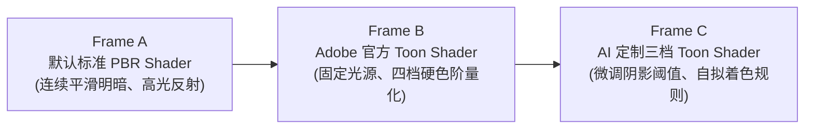

# Painter AI Best Practice B｜用 AI 修改 GLSL Toon Shader 的光影规则

> **治理与门禁定位 (Governance & Status)**：  
> - **承载工单**：[Issue #42](https://github.com/carllx/corso-pbr-materials/issues/42)（关联主线工单 [Issue #40](https://github.com/carllx/corso-pbr-materials/issues/40)）  
> - **总览索引**：[`painter-ai-workflow-research-index.md`](painter-ai-workflow-research-index.md)  
> - **建议周次**：W8 自发光材质制作与视口呈现附近（6–10 分钟教师演示候选，学生选做）  
> - **依据属性**：`RESEARCH CANDIDATE / RUNTIME REQUIRED / NOT TEACHER-APPROVED`  
> - **术语规范**：严格执行 **English-first**（`GLSL Shader`、`Shader Settings`、`Base Color`、`Roughness`、`Metallic`、`Specular Highlight`、`Diffuse Reflection` 等），中文仅作辅助解释。

---

## 1. 为什么做：实时着色规则定制的教学价值

本案例的核心教学目标，是让艺术专业学生直观建立以下深刻认知：  
**“同一个三维模型、同一套材质贴图，在保持 `Base Color` 内容完全不变的前提下，仅仅改变视口的实时光栅化着色计算规则，就能彻底改变物体的视觉语言与艺术风格。”**

案例通过严格控制变量的**同资产三段视觉对照 (Three-Stage Comparison)** 展开：



- **对照 A $\to$ B**：证明 Substance 3D Painter 官方支持底层 Shader 定制与切换，视口不仅能显示物理写实 PBR，也能呈现非真实感渲染（NPR / Toon）；
- **对照 B $\to$ C**：证明学生借助 AI，无需精通复杂图形学即可读懂并改写着色器内部的关键阈值，按自己的艺术意图定制视觉规则。

> [!NOTE]
> GLSL Shader 与 Python Plugin 属于完全正交的不同技术维度：Python 扩展的是软件界面与管线工具，而 GLSL 决定的是视口中像素如何被光照渲染。

---

## 2. Adobe 官方复刻权威与技术可用性

所有着色器修改与验证必须基于以下官方一手技术文档：

1. **着色器体系官方入口**：Adobe [Shader API Reference](https://experienceleague.adobe.com/en/docs/substance-3d-painter/using/scripting-and-development/shader-api-reference/shader-api)  
   定义了 Painter 表面着色器的核心结构 `void shade(V2F inputs)`、输入顶点结构、内置全局变量及通道采样函数。
2. **卡通着色器源码依据**：Adobe [Toon Shader API](https://experienceleague.adobe.com/en/docs/substance-3d-painter/using/scripting-and-development/shader-api-reference/shaders-shader-api/toon-shader-api)  
   提供官方完整的 Toon Shader 源代码：包含对 `Base Color` 的采样、固定光源向量、法线与光照夹角点积（$N \cdot L$）分级、四档阴影阈值及轮廓线厚度计算。
3. **着色器参数调节面板**：Adobe [Shader Settings](https://experienceleague.adobe.com/en/docs/substance-3d-painter/using/interface/shader-settings/shader-settings)  
   官方说明如何在视口面板中切换 Shader、实例化 Shader 及实时调节着色器中暴露的 `uniform` 参数。
4. **自定义着色器导入指南**：Adobe [Custom Shaders](https://experienceleague.adobe.com/en/docs/substance-3d-painter/using/features/custom-shaders)  
   规范了如何将外部编写的 `.glsl` 文件导入 Painter 资源库作为着色器资源使用。
5. **视觉参考（非代码权威）**：[Pablo Muñoz Gómez 2025 视频教程](https://www.youtube.com/watch?v=Vxk_ftSpKsA)  
   提供了优秀的卡通材质视口设置与参数调优视觉参照。其第三方资产未获课堂再分发授权，本案例不依赖其任何代码或资产。

---

## 3. 输入资产与预期成果

- **输入资产**：
  - 教师预先准备的轻量级低多边形头像或几何道具 `.spp` 工程；
  - 资产与学生 W7–W9 期末个人大作业彻底物理隔离，避免修改冲突；
  - 预设已配置好稳定的固有色（`Base Color`）与固定摄像机机位；
  - 关闭重量级 SSS、Iray 渲染及曲面细分（Tessellation），确保低配机房 GPU 安全。
- **着色器代码序列**：
  - `hello.glsl`：官方最小着色器，用于装载冒烟测试；
  - `toon_original.glsl`：Adobe 官方原版卡通着色器（四档明暗）；
  - `toon_three_bands.glsl`：AI 辅助修改版（将四档阴影阶梯调整为更简练的三档，或自定义暗部阴影色调）。
- **预期成果**：
  - 在完全一致的相机视角、网格模型与贴图通道下，导出三张对照截图（`default_pbr.png`、`official_toon.png`、`ai_modified_toon.png`）；
  - 留存对应的 `.glsl` 源文件与视口编译日志。

---

## 4. 教师可复刻演示流程 (7 步法)

1. **固化默认 PBR 基准画面**：
   在 Painter 中以默认 `pbr-metal-rough` 着色器打开测试模型，记录固定的摄像机视角与光源环境，截取画面 A 作为写实物理渲染基准。
2. **向 AI 提出着色器定制需求**：
   教师示范提问词：“请查阅 Adobe Substance 3D Painter 官方 Toon Shader 源码。不要重新编写庞大的通用渲染器，仅在官方示例基础上，将四档明暗量化算法精简修改为三档（亮面、中间过渡色、暗面），并解释修改的代码行与回退方案。”
3. **冒烟测试 (Smoke Test)**：
   导入极简的 `hello.glsl` 验证着色器加载流程。**若视口出现纯粉红色，需核查 Painter 底部日志是编译 Syntax Error 还是 Uniform 缺失。**
4. **导入并应用官方 Toon 原版**：
   将 `toon_original.glsl` 拖入资源架（资源类型指定为 `Shader`），在 `Shader Settings` 中切换为该着色器，获得四档量化卡通画面 B。若着色器包含曲率图（Curvature）依赖，初次演示时保持禁用，消除外部依赖。
5. **导入并应用 AI 修改版**：
   导入 `toon_three_bands.glsl` 并切换，直观观察模型表面的明暗交界带从四层变成三层。若编译报错，将 Painter 错误日志完整反馈给 AI，由其做针对性修复，严禁随意删除着色器结构。
6. **重开与回退验证**：
   保存工程并重新打开，确认自定义 Shader 资源正确持久化；在 `Shader Settings` 中一键切回默认 PBR 着色器，证明工程可无损复原。
7. **引导学生认知提问**：
   “为什么我们改动着色器后，完全没有重画 `Base Color`，画面风格就从写实变成了动漫？为什么这个动漫效果无法通过普通的 `Export Textures` 输出？”

---

## 5. 复杂度分层与安全减法规则

- **最低演示闭环（必须首先满足）**：
  Hello 着色器冒烟测试 $\to$ 官方原版 Toon $\to$ AI 仅修改 1 个量化阶梯；教师主导演示，不额外增加复杂 UI 滑块。
- **可选增强路线（通过基础门禁后）**：
  让 AI 在着色器中增加一个自定义 `uniform float` 参数，在 `Shader Settings` 实例中暴露出控制阴影过渡位置的调节滑块。仅在机房负荷与课时充分时选做。
- **坚决不做的边界**：
  - 严禁尝试在 GLSL 中完整重写光线追踪或全局光照；
  - 严禁试图让 Shader 自动生成所有可导出的 PBR 贴图；
  - 严禁将视口 Toon 画面包装成“已经可以无缝导入 Blender 渲染的成品贴图”。

---

## 6. 核心科学与教学边界

1. **着色计算 $\neq$ 材质通道数据**：
   `Shader` 是在 GPU 上执行的着色算法，决定如何将光照与贴图数据映射为屏幕像素；而 `Base Color`、`Roughness` 是存储在贴图上的固有属性。
2. **视口视觉效果 $\neq$ 导出贴图 (Viewport $\neq$ Textures)**：
   Substance 3D Painter 的 `Export Textures` 默认导出的是二维材质贴图。要在下游渲染器（如 Blender Cycles/Eevee 或游戏引擎）中获得同等的 Toon 画面，通常必须在下游软件中搭建对应的着色节点，**无法直接通过贴图迁移**。
3. **原生功能权威对照**：
   Painter 官方已内置 Toon 样例；教学中必须清晰证明 AI 改动的差异化价值，不得误导学生认为官方软件无法呈现卡通效果。
4. **物理真实性定界**：
   Toon 属于风格化渲染（NPR），明暗量化破坏了能量守恒与微平面物理定律，不能与标准 PBR 混淆。

---

## 7. 为什么建议 W8 展开（而非 W1 / W7 / W9）

- **排除 W1**：第一讲必须专注最核心的 Base Color、Roughness、Metallic 认知与填充层/黑遮罩，过早引入着色器代码会导致认知超载；
- **排除 W7**：第七讲 SSS 次表面散射本身属于重型光学概念，机房显卡渲染负荷较重；
- **排除 W9**：第九讲为期末大作业最终收官周，必须将全部精力留给学生综合制作；
- **契合 W8 逻辑**：第八讲课题为“自发光材质与视口呈现”，教学中已涉及辉光（Bloom）、曝光与视口渲染机制（LookDev）。此时利用 6–10 分钟展示“着色器如何改变视觉语言”，在逻辑上顺理成章，且与自发光视觉呈现形成有效补充。若遇课时紧张，可随时取消演示或转为课后拓展，绝不拖累期末进度。

---

## 8. 验收标准与留存记录模板

必须满足以下条件方可判定通过：
- 真实机房显卡上三帧画面均能稳定渲染，AI 修改版与官方版呈现清晰可辨的阴影阶梯差异；
- 资源保存重开无丢失，可无缝回退至默认 PBR 着色器；
- 学生能准确表述：“**我们改变的是 Shader 计算光照的阶梯，而不是重画贴图**，且视口效果不等于导出贴图”。

```yaml
Validation Timestamp: ""
Target Painter Version: ""
GPU Model & Driver Status: ""
Official Toon Shader Source Verification: ""
AI Modified GLSL Diff Summary: ""
Compilation Log Status (No Errors): ""
3 Comparison Frames Captured (PBR / Official Toon / AI Toon): ""
Shader Revert & Non-Destructive Verification: ""
Student Explanation Evidence: ""
Comprehensive Verdict: "NOT TESTED / RUNTIME REQUIRED"
```
