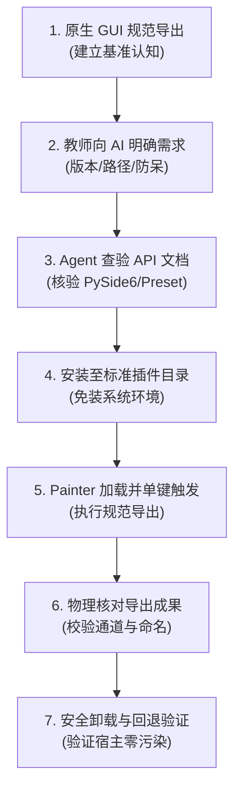

# Painter AI Best Practice A｜用 AI 为 Substance 3D Painter 制作 Python 规范化导出工具

> **治理与门禁定位 (Governance & Status)**：  
> - **承载工单**：[Issue #42](https://github.com/carllx/corso-pbr-materials/issues/42)（关联主线工单 [Issue #40](https://github.com/carllx/corso-pbr-materials/issues/40)）  
> - **总览索引**：[`painter-ai-workflow-research-index.md`](painter-ai-workflow-research-index.md)  
> - **建议周次**：W6 `Export Textures` 与跨软件连接之后（5–8 分钟教师演示候选，学生选做）  
> - **依据属性**：`RESEARCH CANDIDATE / RUNTIME REQUIRED / NOT TEACHER-APPROVED`  
> - **术语规范**：严格执行 **English-first**（`Python Plugin`、`Texture Set`、`Export Textures`、`Output Template`、`Base Color`、`Roughness`、`Metallic`、`Normal` 等），中文仅作辅助解释。

---

## 1. 为什么做：教学痛点与核心价值

本案例**不是为了向艺术专业学生教授 Python 语法**，也不是为了把“点击 Export 按钮”机械地替换为“点击另一个脚本按钮”。

Substance 3D Painter 原生具备功能完备的 `File > Export Textures` 面板与 `Output Templates`（输出模板），已支持对文件名通配符、贴图格式、位深度、色彩空间及多通道打包进行预设化配置。

**要产生真实教学增益，必须对准反复导出时的易错情境**：
- 在复杂模型贴图阶段，学生微调某一通道后需要反复导出到引擎进行材质测试；
- 容易因误选输出模板、输出路径混乱或覆盖历史文件导致引擎端连接失效；
- 借助 AI 引导学生将一组固定的导出规则编写为 Painter 内部单键触发的规范插件，让学生切身感受 **AI 辅助如何帮助艺术创作者沉淀工作流标准、减少低级机械错误**。

> [!CAUTION]
> **反模式警示**：严禁将本案例设计为“用 Python 生成木纹/石纹贴图”。这类图片生成任务已有成熟的生图 AI 工具覆盖，完全无法证明调用 Substance 3D Painter Python API 的独特管线价值。

---

## 2. Adobe 官方复刻权威与技术可用性

所有脚本生成与验证必须基于以下 Adobe 官方技术依据：

1. **原型依据**：Adobe [Create a Python plugin](https://experienceleague.adobe.com/en/docs/substance-3d-dev/painter-python/tutorials/create-a-python-plugin)  
   提供了基于当前选定 `Texture Set` 导出贴图的完整官方原型代码、菜单注册与执行步骤。
2. **兼容性关键预警**：Adobe [Qt6 Migration](https://experienceleague.adobe.com/en/docs/substance-3d-dev/painter-python/tutorials/qt6-migration)  
   Substance 3D Painter 自 10.1+ 版本起底层迁移至 Qt6/PySide6；`QtWidgets.QAction` 现已归入 `QtGui.QAction`。**官方旧教程中依然包含 PySide2 历史写法，严禁未经版本核验直接分发给学生。**
3. **API 接口规范**：Adobe [Python export module](https://experienceleague.adobe.com/en/docs/substance-3d-dev/painter-python/api/substancepainter-package/export)  
   规范了 `export_project_textures()` 核心导出函数、预设参数结构、错误码及执行结果字典。
4. **扩展骨架参考**：Adobe [Versioning Plugin Example](https://experienceleague.adobe.com/en/docs/substance-3d-dev/painter-python/examples/versioning-plugin)  
   展示了规范的 PySide6 界面集成、异常捕获以及多纹理集遍历骨架。
5. **基准对照组**：Adobe [Native Export Textures](https://experienceleague.adobe.com/en/docs/substance-3d-painter/using/export/export)  
   作为原生 GUI 对照标准。课堂中绝不可向学生误传“只有写代码才能导出”的错误信息。

---

## 3. 输入资产与预期成果

- **输入资产**：
  - 教师预先准备并已保存的轻量化布料测试工程（如 `fabric_demo.spp`，严禁使用学生重要作业工程）；
  - 已配置基础通道：`Base Color`、`Roughness`、`Metallic`、`Normal`；
  - 目标版本 Substance 3D Painter 运行宿主。
- **产出脚本**：
  - `class_export.py`：基于官方示例适配目标版本的极简插件；
  - 在软件顶部 `File` 菜单注册 `Class Export` 菜单项；
  - 执行时自动检测工程状态，将当前 Texture Set 贴图导出到工程根目录下的独立 `exports_demo/` 子文件夹。
- **预期成果**：
  - 导出目录生成符合指定 `Output Template` 命名规范的位图文件序列；
  - 教师与学生能对照原生 GUI 导出结果，验证贴图分辨率、位深与色彩空间无漂移。
- **对照证据**：
  - 记录“原生 GUI 手动操作”与“插件单键触发”在两次微调导出中的耗时对比与错误率差异。

---

## 4. 教师复刻与教学演示流程 (7 步法)



1. **先做无编程原生版本**：
   教师在 `File > Export Textures` 窗口中选择目标 `Output Template` 完成一次导出，重点讲解 `Base Color`、`Roughness`、`Metallic`、`Normal` 的来源、位深度（Bit Depth）、边缘留白（Padding）与颜色空间设置（sRGB vs Linear/Raw）。**学生必须先理解基础导出规范。**
2. **向 AI 提出精准自动化需求**：
   教师向 AI 示范提问词：“针对 Substance 3D Painter [目标版本号]，基于 Adobe 官方 Python export plugin 示例，制作一个仅导出当前激活 Texture Set、统一输出到当前工程旁独立 `exports_demo/` 目录的菜单插件。要求：复用既定 Output Template；导出前预检工程已保存；通过 API 提示成功或失败日志；不修改其他通道；不依赖外部第三方库。”
3. **查验官方 API 文档**：
   核对目标版本的导出模块接口定义与 Qt6 兼容性。若预设名称或路径结构在目标版本有差异，由 AI 修正，严禁凭空臆造 API。
4. **保存与安装插件**：
   将生成的 `class_export.py` 存放在官方插件路径下（如用户文档目录 `Adobe/Adobe Substance 3D Painter/python/plugins/`）。**全程无需安装系统 Python 或配置任何外部环境变量。**
5. **在 Painter 内启用并运行**：
   在 Painter 菜单栏 `Python` 中刷新或勾选该插件；在 `File > Class Export` 点击执行。
6. **物理核对输出文件**：
   打开文件管理器，对比原生手动导出与 Python 脚本导出的贴图数量、命名格式、文件体积与通道对应关系。若未能展现出效率提升或规范保护，应如实判定“本案例不宜进入课堂实操”。
7. **环境复原与回退**：
   演示关闭该插件或移除 `.py` 文件，重启软件，确认 Painter 原生功能毫无损坏。

---

## 5. 学生认知闭环：四句话与核心追问

向学生传达的核心心智模型：
> 1. “我告诉 AI 想要固定的导出规范与防呆规则；”  
> 2. “AI 查验 Adobe 官方对应版本的 API 编写脚本；”  
> 3. “我将 `.py` 文件放入 Painter 原生插件目录并一键启用；”  
> 4. “我打开输出目录，用贴图结果验证它是否严格符合规范。”

**关键教学追问**：
> “既然单次点击 Export Textures 也能导出，为什么在团队协作、多人规范统一或高频迭代时，需要让 AI 帮我们把工作流沉淀为内部小工具？”

---

## 6. 风险清单与安全减法规则

- **版本与接口兼容风险**：
  Painter 10.1 前后 Qt 库重大变更（PySide2 $\to$ PySide6）。切忌从旧博客复制粘贴废弃代码，必须现场核对软件关于菜单注册的真实报错。
- **机房账户权限风险**：
  部分高校机房对 `C:\Program Files` 或系统根目录有严格还原卡或只读限制。必须验证用户主目录（`~/Documents`）的写入权限。
- **工程上下文未保存风险**：
  新建未命名的临时工程无物理路径，直接调用脚本容易抛出空指针异常。脚本必须具备“未保存则弹窗提示”的防呆保护。
- **生产数据覆盖风险**：
  脚本输出路径必须硬编码为独立演示子目录（`exports_demo/`），严禁递归覆盖上级目录或其他项目文件夹。
- **范围蔓延减法规则**：
  坚决杜绝在机房安装 Anaconda、Node.js、VSCode 等重型环境；不做跨软件 RPC 远程遥控；JavaScript/QML 仅留作教师课后参考，不作为学生必学内容。

---

## 7. 教学通过与准入标准 (Pedagogical Gate)

只有满足以下条件，本案例才具备进入课堂演示的资格：
- 脚本在真实机房的 Substance 3D Painter 中无报错加载，普通学生系统权限下可正常读写；
- 连续两次微调导出测试中，相比原生手动配置展现出直观的效率优势；
- 5–8 分钟内教师能清晰阐述“原生功能与脚本自动化的边界”，学生不产生编程焦虑；
- 学生能明确回答：“Python 改变的是**软件界面的工作流与操作按钮**，没有改变贴图像素的 PBR 物理计算原理”；
- **若脚本出现环境报错、权限受阻或操作步骤比原生点击更繁琐，方案立即终止，退回原生 Native Export 教学。**

---

## 8. 受控验证留存证据模板

未来在机房或受控环境实测时，必须记录以下指标：

```yaml
Validation Timestamp: ""
Target Painter Version: ""
Operating System & User Permission: ""
Official Tutorial & API Version: ""
Class Export Script SHA: ""
Native GUI Export File List & Size: ""
Python Script Export File List & Size: ""
Operation Time Comparison (GUI vs Script): ""
Error Recovery & Revert Status (PASS/FAIL): ""
Student Comprehension Feedback: ""
Comprehensive Verdict: "NOT TESTED / RUNTIME REQUIRED"
```
