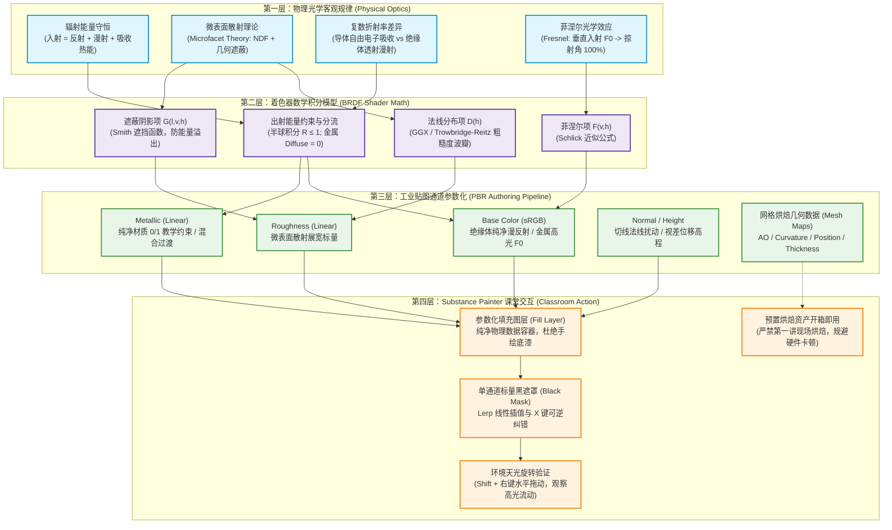

# 第一讲 PBR 概念与材质通道教学知识证据研究报告 (勘误与加固版)
## (NotebookLM-Driven Pedagogical Evidence Report for Lesson 1 - Hardened & Corrected)

> **治理与元数据规范 (Governance & Metadata)**：  
> - **所属项目**：`corso-pbr-materials`（广州软件学院 GR2102《三维数字材质制作》）  
> - **关联任务与工单**：[Issue #40](https://github.com/carllx/corso-pbr-materials/issues/40)（Painter-first 第一讲 MeetMat 教学设计）/ PR #41 备课审查支撑  
> - **研究模式**：Run-to-Gate 模式（基于真实文献检索、跨源比对核验、有界勘误与教学转译）  
> - **核心知识底座 (Knowledge Base)**：Course Knowledge Notebook (`e29f9644-03b2-4e1b-bcb0-b954b5bf08be`)  
> - **一手权威文献与溯源索引 (`SOURCE-BACKED`)**：
>   1. **Adobe / Allegorithmic — *The PBR Guide: A Guide to Physically Based Rendering*** (by Wes McDermott, 3rd ed., 2018):
>      - *Part 1: The Theory of PBR* (Light-matter interactions, Microfacet theory, Conservation of Energy, $F_0$ parameters; pp. 8–37, Figures 12, 15, 63);
>      - *Part 2: Practical Guide to PBR* (Metallic/Roughness vs Specular/Glossiness, Fringing artifacts, Resolution & Texel density; pp. 12–19, Figures 34, 35, 42, 43).
>   2. **Tomas Akenine-Möller, Eric Haines, Naty Hoffman et al. — *Real-Time Rendering, 4th Edition (RTR4)*** (CRC Press, 2018):
>      - *Chapter 9: Physically Based Shading* (§9.1–§9.9, pp. 308–342; Table 9.1 Dielectrics, Table 9.2 Metals, Table 9.3 Semiconductors; Equation 9.26 Microfacet BRDF).
>   3. **Sébastien Lagarde — *DONTNOD Physically Based Rendering Chart for Unreal Engine 4*** (2014) (*The PBR Guide* $F_0$ 数值表的原始直接出处).
>   4. **清华大学出版社 郑琳 —《Substance 3D Painter 游戏贴图绘制与材质制作》** (2024年2月第1版, 审批表登记选用教材):
>      - 第一章 PBR 材质基础原理与贴图体系 (§1.1～§1.6, 印刷页 1～12 / 物理页 11～22).
>   5. **Academy Software Foundation — *OpenPBR Surface Specification v1.1*** (2024).
>   6. **Adobe Substance 3D Painter 官方文档** (Baking Mode, Mesh Maps, Layer Stack, Generators).
> - **证据分级与方法论纪律 (Evidence Discipline)**：
>   - `SOURCE-BACKED`：必须对应可精确定位的权威一手文献、原著图表、标准规范章节（严禁将 AI 综合文本伪装为原始事实）；
>   - `PROJECT INFERENCE`：针对单师大班（35人/160分钟）认知负荷、初学者防呆与排错容灾所作的教学法转译与裁剪推论；
>   - `UNKNOWN / RESEARCH REQUIRED`：语料缺乏或未经真实机房实测闭环的待研究缺口；
>   - `RUNTIME REQUIRED`：实操验证仅对特定宿主环境（如 macOS Painter 7.2）生效，严禁自动泛化为目标 Windows 机房已验证；
>   - `TEACHER ACCEPTED`：课程负责人已权威采纳的教学大纲与艺术引导四步闭环原则。

---

## 0. 本轮勘误与加固决策结论对照表 (Triage & Alignment Matrix)

针对首轮研究报告中出现的概念混淆与过度绝对化断言，本轮执行严密核对并形成清晰的“可吸收 / 需修改 / 延后”对照结论：

```
┌──────────────────────────────────────────────────────────────────────────────────────────────────┐
│                            首轮研究发现教学审查与定点勘误对照矩阵                                │
├───────────────┬───────────────────────────────┬──────────┬───────────────────────────────────────┤
│ 主题模块      │ 审查前状态 / 发现问题         │ 审查裁决 │ 勘误与加固处理方案                    │
├───────────────┼───────────────────────────────┼──────────┼───────────────────────────────────────┤
│ 工作流比较    │ 错误断言“Metal/Roughness 天然 │ **需修改**│ 彻底删除“免疫”错误！据 PBR Guide Pt 2  │
│ (Workflow)    │ 免疫边缘插值伪影”             │ (Revise) │ 阐明 MR 产生显眼白边，SG 产生隐蔽黑边；│
│               │                               │          │ 两者皆受分辨率与 UV 纹素密度约束      │
├───────────────┼───────────────────────────────┼──────────┼───────────────────────────────────────┤
│ 能量守恒定律  │ 错误表述“能量守恒倒逼贴图规范 │ **需修改**│ 彻底剥离错误因果！说明守恒是着色器内部│
│ (Conservation)│ 或手绘光影直接破坏守恒”；     │ (Revise) │ 算法物理约束，BaseColor 禁画光影是光照│
│               │ 遗漏内部吸收转化为热能过程    │          │ 解耦制作规范；补齐折射光内部吸收机制  │
├───────────────┼───────────────────────────────┼──────────┼───────────────────────────────────────┤
│ 金属度与阈值  │ 将 235 阈值称为“工作室经验”； │ **需修改**│ 明确 235–255 出自 Adobe PBR Guide Pt 2│
│ (Metallic)    │ 未讲明纯净 0/1 与微观灰度成因 │ (Revise) │ 原始制作指南；说明纯净材质 0/1 教学纪 │
│               │                               │          │ 律与微观混合（浮尘/锈迹/插值）灰度成因│
├───────────────┼───────────────────────────────┼──────────┼───────────────────────────────────────┤
│ F0 数值表     │ 塑料写成 59 产生不一致；      │ **延后** │ 严格复算：标准分段 sRGB 为 56，Gamma  │
│ (F0 Tables)   │ 未区分转换公式与出处          │ (Defer)  │ 2.2 为 59，均给出权威出处；详细表 DEFER│
├───────────────┼───────────────────────────────┼──────────┼───────────────────────────────────────┤
│ Normal/Height │ 声称 POM 或 Height 会改变外轮 │ **需修改**│ 严格四层机制解耦：Normal/Painter原生/ │
│ /位移机制     │ 廓剪影；未区分着色器机制      │ (Revise) │ POM/真实几何位移；强调 POM 不改变轮廓 │
├───────────────┼───────────────────────────────┼──────────┼───────────────────────────────────────┤
│ 教学主线      │ MeetMat 基础三通道与双层黑遮罩│ **可吸收**│ 坚决守住第 30 分钟动手微循环，保持零  │
│ (Teaching)    │ 教学法                        │ (Accept) │ 额外作业负担与 160 分钟安全红线       │
└───────────────┴───────────────────────────────┴──────────┴───────────────────────────────────────┘
```

---

## 1. 教材第一章科学性与教学解释审查 (Critical Audit of Zheng Lin 2024 Ch 1)

以清华大学出版社郑琳《Substance 3D Painter 游戏贴图绘制与材质制作》（2024）第一章（§1.1～§1.6，印刷页 1～12 / 物理页 11～22）为审查对象，对照 *The PBR Guide* 与 *Real-Time Rendering 4th Edition (RTR4)* 进行科学性、教学可转译性及潜在误导性审查。

### 1.1 §1.1 & §1.2：PBR 的本质、目标与边界审查
- **教材表述**：教材将 PBR 描述为“利用物理学规律来计算光线在物体表面的反射与折射，从而使渲染出来的画面更加逼真、符合现实”（印刷页 1~2）。
- **权威事实 (`SOURCE-BACKED`)**：
  - *The PBR Guide Part 1* (p. 8) 明确指出：PBR 并不是“绝对真实”的代名词，而是一种**遵循光学守恒定律的可预测着色方法论 (predictable shading methodology)**。
  - **核心目标 (Core Goal)**：**光照环境不变性 (Lighting Invariance)** 与跨平台一致性。传统非 PBR 材质在贴图中画死高光、阴影和环境反射，换一个场景就会严重“穿帮”；PBR 材质将固有材质属性（如 Base Color、Roughness、Metallic）与外部动态光照彻底解耦，确保资产在正午、黄昏或室内霓虹灯下均自洽。
  - **适用边界 (Applicable Boundary)**：PBR 基于**几何光学与微观统计光学近似**（假设宏观多边形表面平滑，亚像素粗糙度符合微表面统计分布）。它不处理极端纳米级波动光学（如薄膜干涉、衍射，需额外着色器扩展）、量子效应或宏观网格大形变。
- **教学转译结论 (`PROJECT INFERENCE`)**：
  - 教材偏重“写实逼真”，容易让初学者误以为非写实（如二次元、卡通）风格不需要 PBR。
  - 教学应转译为：**“一次制作，任何场景不穿帮”**，PBR 是现代三维数字资产工业标准化的底层通用规范。

### 1.2 §1.3.1：微表面模型 (Microfacet Model) 的科学定界
- **教材表述**：教材用简单的微小镜面比喻物体表面微观凹凸不平，并直接引出粗糙度参数（印刷页 3~4）。
- **权威事实 (`SOURCE-BACKED`)**：
  - *RTR4* (§9.8, pp. 333–342) 与 *The PBR Guide Part 1* (pp. 12–15) 指出：微表面理论是 **Cook-Torrance 镜面反射 BRDF** 的核心几何与物理基础：
    $$f_{\text{spec}}(\mathbf{l}, \mathbf{v}) = \frac{D(\mathbf{h}) \cdot F(\mathbf{v}, \mathbf{h}) \cdot G(\mathbf{l}, \mathbf{v}, \mathbf{h})}{4 (\mathbf{n} \cdot \mathbf{l}) (\mathbf{n} \cdot \mathbf{v})}$$
  - 微表面理论**绝不仅解释 Roughness**，它由三个严谨项共同定义：
    1. **法线分布函数 $D(\mathbf{h})$ (NDF)**：微观法线 $\mathbf{m}$ 沿半角向量 $\mathbf{h}$ 的朝向聚集浓度，决定高光波瓣的形状、尺寸与衰减长尾（现代默认采用 GGX / Trowbridge-Reitz 分布）；
    2. **几何遮蔽阴影函数 $G(\mathbf{l}, \mathbf{v}, \mathbf{h})$**：微观表面自遮挡（Shadowing 遮挡入射光，Masking 遮挡反射视线），防止掠射角能量溢出；
    3. **菲涅尔项 $F(\mathbf{v}, \mathbf{h})$**：在微观平面与半角向量 $\mathbf{h}$ 之间计算局部反射率，而非仅在宏观法线 $\mathbf{n}$ 上计算。
- **教学转译结论 (`PROJECT INFERENCE`)**：
  - 学生端认知：只需理解**“微观平静湖面（高光聚焦锐利） vs 粗糙砂纸（高光散射漫晕）”**，直观映射到 `Roughness` 滑块（0.10 锐利，0.85 哑光）；
  - 教师端背景知识：熟知 $D, F, G$ 三要素，避免在讲台上将微表面理论与单一粗糙度滑块简单画等号。

### 1.3 §1.3.2：能量守恒定律 (Energy Conservation) 与 Base Color 规范的剥离
- **教材表述**：出射光总能量不能大于入射光总能量；光线分为漫反射和高光反射，金属没有漫反射（印刷页 4~5）。
- **权威事实与科学勘误 (`SOURCE-BACKED`)**：
  - *The PBR Guide Part 1* (pp. 10–12) 与 *RTR4* (§9.3, pp. 308–313)：
    - **完整物理过程**：入射光照射到不透明介质表面时，能量守恒严格表现为：
      $$\text{入射辐射通量} = \text{表面镜面反射 (Specular)} + \text{折射进入介质的光 (Refracted)}$$
      折射光在介质内部进一步分流：
      $$\text{内部折射光} = \text{微观多次散射重新出射 (Diffuse)} + \text{介质吸收转化为热能 (Absorption)} + \text{穿透透射 (Transmission)}$$
    - **电介质（绝缘体）**：表面镜面反射比例为 $F$（垂直入射约 2%~5%），折射进入内部的光（约 95%~98%）在内部微观粒子间散射；部分波长被吸收转化为热能，未被吸收的波长重新穿出表面形成**漫反射（Diffuse / Base Color）**；
    - **导体（纯金属）**：由于存在大量自由电子，折射进入内部的光在极薄表层（纳米尺度）被**自由电子全部吸收转化为热能**，无法重新穿出表面。因此纯金属**漫反射严格为 0**，其全部出射光由高反射率（70%~95%）且带波长吸收的镜面反射（$F_0$）构成。
- **教学审查与转译结论 (`PROJECT INFERENCE`)**：
  - **明确区分“物理约束”与“贴图规范”**：能量守恒是着色器内部算法强制执行的数学积分约束（$\int_{\Omega} f \le 1$）；
  - **贴图制作规范**：要求 Base Color 保持纯净、**严禁手绘高光光斑与深度阴影**，是一套**工业资产制作规范 (Authoring Rule)**，目的是使材质能交由引擎着色器根据动态光源实时解算，防止视口旋转光照时光斑重叠穿帮。

### 1.4 §1.4：两种工作流对比与边缘伪影科学勘误
- **教材表述**：列举金属度/粗糙度（Metallic/Roughness）与高光/光泽度（Specular/Glossiness）两套流程（印刷页 6~10）。
- **权威事实与关键勘误 (`SOURCE-BACKED`)**：
  - *The PBR Guide Part 2* (pp. 12–19, Figures 34, 35, 42, 43)：两套工作流描述的是 **100% 相同的物理现实**，底层均求解相同的 microfacet BRDF。
  - **边缘伪影 (Edge Artifacts / Fringing) 事实澄清**：
    > [!CAUTION]
    > **首轮报告关键错误更正**：此前断言“Metal/Roughness 天然免疫边缘伪影”属于事实错误，必须彻底撤销！
    - **两套工作流在材质过渡边界都会产生边缘伪影**，其根源是 GPU 纹理采样时的双线性过滤（Bilinear Filtering）与 Mipmap 插值下采样；
    - **Metallic/Roughness 产生显眼的“白边伪影 (White Fringe / Halo)”**：在金属与非金属交界处，Base Color 在金属侧存有高亮反射率（180–255 sRGB），非金属侧存有暗漫反射色。插值时过渡像素带有较高亮度，而此时金属度遮罩插值若判定其为非金属，着色器就会将高亮颜色当作漫反射渲染，在交界处产生一圈**极刺眼的白色高亮轮廓线（Figure 34）**；
    - **Specular/Glossiness 产生隐蔽的“黑边伪影 (Black Fringe)”**：纯金属在 Diffuse 贴图中为纯黑（0 sRGB），插值时与非金属颜色混合导致交界处变暗产生黑边（Figure 42）。McDermott 明确指出：**黑边在视觉上远比白边隐蔽，侵扰度更小**；
    - **解决伪影的真正手段**：并非工作流本身，而是**提高文档贴图分辨率和确保充足的 UV 纹素密度 (Texel Density)**（Figure 35, 43）。
  - **为什么本课程与行业仍坚定采用 Metallic/Roughness 主线？**
    1. **显存与贴图带宽**：Metallic 与 Roughness 均为 1 通道灰度图，可与 AO 紧凑通道打包（Channel Packing）为单张 ORM 贴图；而 Specular 必须占用 3 通道 RGB 贴图，显存开销显著增大；
    2. **防呆与防错机制 (Error Mitigation)**：Specular/Glossiness 允许艺术家在 Specular 贴图中自由涂抹 RGB 颜色，极易给电介质填入过高反射率或彩色高光（打破能量守恒）；Metallic/Roughness 将电介质 $F_0$ 严格锁定为 4% 常数，极大降低了初学者把材质调“出圈”的概率。
- **教学转译结论 (`PROJECT INFERENCE`)**：
  - 第一讲坚定采用单一 Metallic/Roughness 主线，杜绝双流程混讲；边缘伪影理论归入教师背景知识，不向初学者灌输。

### 1.5 §1.5：Substance Painter 工作方式与图层遮罩数学
- **教材表述**：图层堆叠混合，支持实时 3D 视口预览（印刷页 10~11）。
- **权威事实 (`SOURCE-BACKED`)**：
  - Painter 采用通道解耦的并行合成架构，遮罩（Mask）本质上是单通道标量灰度贴图在片元着色器中的**线性插值 (Lerp / Linear Interpolation)**：
    $$\mathbf{C}_{\text{final}} = \mathbf{C}_{\text{Bottom}} \times (1 - \text{Mask}) + \mathbf{C}_{\text{Top}} \times \text{Mask} \quad (\text{Mask} \in [0.0, 1.0])$$
- **教学转译结论 (`PROJECT INFERENCE`)**：
  - 第一讲必须树立**“参数化填充图层 (Fill Layer) + 黑色遮罩 (Black Mask) = 工业级非破坏性制作”**的心智；
  - 严禁第一讲让学生直接使用手绘普通图层（Paint Layer）上色，建立“做坏了按 X 键切黑画笔擦除”的可逆排错直觉。

### 1.6 §1.6：辅助贴图与材质通道的二分法边界审查
- **教材表述**：平铺罗列 AO、法线、高度、粗糙度、金属度等贴图（印刷页 11~12）。
- **权威事实与边界消除 (`SOURCE-BACKED`)**：
  - 必须建立清晰的**二分法功能边界**：
    1. **PBR 材质输出通道 (Render Channels)**：Base Color、Roughness、Metallic、Normal、Height（以及 Emissive、Opacity）。它们是最终导出并直接提供给外部引擎渲染器片元着色器的通道贴图；
    2. **网格辅助烘焙贴图 (Mesh Maps / Baked Maps)**：AO、Curvature、World Space Normal、Position、Thickness、ID。它们是基于三维几何网格计算的空间数据，在 Painter 内部**主要作为智能材质、智能遮罩与生成器（Generators）的计算驱动源**，辅助自动化识别磨损与沉积；
    - *纠偏*：部分网格图（如 AO、World Space Normal）在特定管线中也会被外部引擎着色器直接消费（如环境遮蔽或引擎内部积雪着色器），不能简单写成“绝对只能在 Painter 内部使用”。
- **教学转译结论 (`PROJECT INFERENCE`)**：
  - 第一讲选用官方 `MeetMat`（已预置高质量烘焙贴图），**坚决禁止带学生打开烘焙模式 (Baking Mode)**，封印硬件卡顿风险。

---

## 2. PBR 概念依赖关系图 (Research Dependency Graph)



---

## 3. 各通道形象解释与最小控制变量实验候选矩阵 (Core Channels Matrix)

```
┌──────────────────────────────────────────────────────────────────────────────────────────────────┐
│                            PBR 五大核心渲染通道教学参数与实验矩阵                                │
├──────────┬───────────────────┬──────────────┬──────────────┬───────────────┬─────────────────────┤
│ 通道名称 │ 存储类型与空间    │ 物理学定义   │ 生活化比喻   │ 学生高频误区  │ 最小单变量验证实验  │
├──────────┼───────────────────┼──────────────┼──────────────┼───────────────┼─────────────────────┤
│ Base     │ 3通道 RGB         │ 绝缘体漫反射 │ 纯净底漆     │ 手绘高光阴影  │ 固定视角，旋转天光；│
│ Color    │ sRGB 色彩空间     │ 金属高光反射 │ (无色差原布) │ 导致旋转穿帮  │ 画死高光者光斑重叠  │
├──────────┼───────────────────┼──────────────┼──────────────┼───────────────┼─────────────────────┤
│ Rough-   │ 单通道灰度        │ 微表面法线朝 │ 平静湖面 vs  │ 误以为粗糙度  │ 固定视角光照，拖动  │
│ ness     │ Linear (非色彩)   │ 向离散分布度 │ 粗糙砂纸     │ 会改变模型凹凸│ 0.10(锐) 到 0.85(散)│
├──────────┼───────────────────┼──────────────┼──────────────┼───────────────┼─────────────────────┤
│ Metallic │ 单通道灰度        │ 导体/绝缘体  │ 导电与绝缘的 │ 随意调成 0.5  │ 对比 0 与 1：高光   │
│          │ Linear (非色彩)   │ 身份参数开关 │ 开关(非黑即白│ 灰色油污脏质感│ 从纯白变为金属固有色│
├──────────┼───────────────────┼──────────────┼──────────────┼───────────────┼─────────────────────┤
│ Normal   │ 3通道 RGB 向量    │ 切线空间法线 │ 立体压纹与   │ 以为改变了轮  │ 视口转到侧面掠射角；│
│          │ Linear (非色彩)   │ 扰动方向编码 │ 凹凸视觉魔镜 │ 廓，拉近穿帮  │ 轮廓线依然笔直平坦  │
├──────────┼───────────────────┼──────────────┼──────────────┼───────────────┼─────────────────────┤
│ Height   │ 单通道灰度        │ 宏观网格表面 │ 真实地形地貌 │ 与法线混淆；  │ 在支持位移管线中；  │
│          │ Linear (非色彩)   │ 垂直高程深度 │ 隆起与地陷   │ 以为必有遮挡  │ 侧面产生真实凹凸遮挡│
└──────────┴───────────────────┴──────────────┴──────────────┴───────────────┴─────────────────────┘
```

### 3.1 Base Color（基础色 / 反照率 Albedo）
1. **解决什么具体问题？** 表达物体材质本身的固有反射属性，彻底剥离外部直射光、阴影与环境光照。
2. **记录或控制什么信息？** 
   - 对**电介质（绝缘体，Metallic=0）**：记录光线在内部微观多次散射后出射的**漫反射颜色 (Diffuse Albedo)**；
   - 对**纯金属（导体，Metallic=1）**：记录表面镜面反射在法线入射角处的**特征反射率颜色 ($F_0$)**。
3. **如何影响可观察的材质效果？** 决定物体的基调色彩；在白光下，绝缘体漫反射呈现该色，纯金属的高光呈现该色。
4. **生活化比喻**：**“汽车工厂喷涂车间的纯净底漆（或未经光照渲染的胚布）”**。
5. **学生最容易误解什么？** 习惯于手绘流程，在 Base Color 上画上亮斑高光或阴影暗部，导致旋转环境光时光斑重叠穿帮。
6. **最小单变量实验**：
   - 建立单色塑料底漆（Metallic=0, Roughness=0.2）；
   - 刻意在图层上手绘一个纯白色假高光点；
   - 按住 `Shift + 鼠标右键水平拖动` 旋转天光：真实物理高光随光源角度顺滑流动，而手绘假白点死死贴在模型表面，发生严重视觉穿帮。
7. **第一讲掌握要求**：**MUST**（全员必修核心通道）。

### 3.2 Roughness（微表面粗糙度）
1. **解决什么具体问题？** 控制高光反射的聚散锐利程度，模拟表面从镜面光滑到磨砂粗糙的质感。
2. **记录或控制什么信息？** 记录亚像素级微表面的平整度与法线分布离散度（GGX 模型的 $\alpha = \text{Roughness}^2$）。
3. **如何影响可观察的材质效果？** 
   - 接近 0.0：表面镜面光滑，高光汇聚为刺眼锐利的光斑，环境倒影清晰；
   - 接近 1.0：表面磨砂多孔，反射光向四面八方发散，高光扩散为极其柔和宽大的漫晕。
4. **生活化比喻**：**“风平浪静的镜面湖泊 vs 狂风骤雨波澜起伏的湖面（光滑镜面 vs 粗糙砂纸）”**。
5. **学生最容易误解什么？** 误以为 Roughness 变大可以让模型表面长出几何凹凸坑洼。
6. **最小单变量实验**：
   - 视口角度与环境光源保持不动；
   - 将底漆 `Roughness` 从 `0.10` 拖动至 `0.85`；
   - 观察 Head 表面高光光斑由锐利亮点平滑扩散为柔和漫晕。
7. **第一讲掌握要求**：**MUST**（开课第 30 分钟全员首次动手核心实验）。

### 3.3 Metallic（金属度）
1. **解决什么具体问题？** 区分材质属于电介质（绝缘体）还是纯金属（导体）。
2. **记录或控制什么信息？** 着色器控制开关：是否关闭内部漫反射，以及高光反射采用无色反射（Achromatic）还是带色反射（Chromatic）。
3. **如何影响可观察的材质效果？** 
   - `Metallic = 0.0`：电介质。漫反射呈现 Base Color 颜色；高光反射率固定为 4%（纯白色，无色高光）；
   - `Metallic = 1.0`：纯金属。漫反射归零；高光反射率达 70%~95%，且高光带有 Base Color 的金属特征颜色（金为金黄，铜为红橙）。
4. **生活化比喻**：**“导电与绝缘的二元物理闸门”**。
5. **学生最容易误解什么？** 误将 Metallic 当作“高光强度调节钮”，随意设置成 0.5 等中间值，使材质变成“半导电怪胎”，呈现油腻灰蒙蒙的脏感。
6. **最小单变量实验**：
   - 将底色设为明黄色；
   - 对比 `Metallic = 0.0`（高光呈纯白光源色）与 `Metallic = 1.0`（高光立刻变为纯金黄色）；
   - 调至 `0.5` 观察非自然的灰色油污感。
7. **第一讲掌握要求**：**MUST**（严格遵守 0 或 1 的制作纪律）。

### 3.4 Normal（法线贴图）
1. **解决什么具体问题？** 在不增加多边形面数的前提下，利用切线空间法向量扰动计算明暗，模拟微细浮雕与倒角。
2. **记录或控制什么信息？** RGB 分别编码切线空间单位法向量 $(X, Y, Z)$ 偏转（平整未扰动为 $(0, 0, 1)$，映射为浅蓝紫色 RGB `(128, 128, 255)`）。
3. **如何影响可观察的材质效果？** 正对视口观察时呈现逼真的立体起伏、划痕压纹明暗。
4. **生活化比喻**：**“立体压纹壁纸与视觉魔镜幻术”**。
5. **学生最容易误解什么？** 误以为法线贴图真正移动了网格几何顶点；拉近至侧面（掠射角）观察时因轮廓依然笔直而穿帮。
6. **最小单变量实验**：
   - 投屏展示带有法线压纹的模型；
   - 将相机旋转至侧面切线掠射角（Grazing Angle）；
   - 放大观察轮廓边缘（Silhouette），边缘依然笔直平坦，证实其为光影明暗假象。
7. **第一讲掌握要求**：**DEMO**（教师投屏演示提点，默认关闭通道以减少初学者干扰）。

### 3.5 Height（高度贴图）与几何位移机制精确定界
1. **解决什么具体问题？** 表达物体表面的宏观高程落差与垂直深度信息（如浮雕、深砖缝、地貌坑洼）。
2. **记录或控制什么信息？** 单通道灰度标量图，黑为下凹，白为凸起（中性灰 0.5 为无位移基准面）。
3. **不同管线下的可观察材质效果与机制严格分层 (`SOURCE-BACKED`)**：
   - **Normal 贴图机制**：仅改变像素着色法线向量，**完全不移动网格顶点，绝不改变外轮廓剪影 (Silhouette)，无视差与自遮挡**；
   - **Substance Painter 原生默认表现**：视口默认着色器将 Height 灰度数据**在内部自动转换为法线扰动并与 Normal 通道实时混合 (Bump-to-Normal)**；在此默认状态下，其本质依然是明暗法线假象，视口侧面完全无位移；
   - **POM (视差遮蔽映射 / Parallax Occlusion Mapping)**：在高级片元着色器中通过视线步进偏移 UV 纹理坐标，在表面内部产生逼真的伪深度视差与内部自遮挡。**但 POM 绝不移动网格几何顶点，物体的外轮廓剪影依然是平坦笔直的低模边缘**，无法改变剪影；
   - **真实几何位移 (Tessellation / Geometry Displacement)**：在细分曲面着色器或离线渲染引擎中，根据 Height 贴图**真正沿法线推移网格物理顶点**。**只有真实几何位移才会真正改变物体的外轮廓剪影**，并在大角度掠射角下呈现真实的物理多边形起伏与阴影。
4. **生活化比喻**：**“等高线地形图”**。
5. **学生最容易误解什么？** 以为只要画了 Height 贴图，模型侧面轮廓就会自动凸出多边形，混淆了法线混合、POM 视差与真实几何位移的边界。
6. **第一讲掌握要求**：**DEFER**（果断延期至后续周次；第一讲仅用 Normal 演示提点）。

---

## 4. 辅助贴图机制与四大历史疑难科学澄清 (Mesh Maps Deep-Dive)

### 4.1 四大历史疑难科学澄清

#### 疑难一：Position（位置贴图）相较于 World Space Normal（世界空间法线）的独立价值
- **科学辨析 (`SOURCE-BACKED`)**：
  - **World Space Normal 回答的是：“表面朝向哪里？(Which WAY is the surface facing?)”** 记录几何表面法向量在三维空间中的方向（如 $+Y$ 代表垂直朝天）。无论表面位于高空还是地面，只要朝天，法线数据完全相同；
  - **Position 回答的是：“表面在三维空间中的具体坐标？(WHERE is the surface located in space?)”** 将模型包围盒坐标 $(X, Y, Z)$ 归一化映射为灰度或色彩贴图，能够精准区分**物体的最顶部、中间与最底部**。
- **教学案例区别 (`PROJECT INFERENCE`)**：
  - **制作“朝天落雪”**：使用 **World Space Normal**，所有朝上的平坦面都会积雪；
  - **制作“雨靴下半截泥浆”**：必须使用 **Position**，仅底部 $Z \in [0.0, 0.2]$ 区域沾泥，靴筒顶部的水平开口绝不能沾泥。

#### 疑难二：Thickness（厚度数据）与次表面散射 (Subsurface Scattering, SSS) 的区别
- **科学辨析 (`SOURCE-BACKED`)**：
  - **Thickness 是静态几何测量数据**：由烘焙器反向光线投射（Ray Casting）测量网格厚度并存为黑白灰度图（黑代表极薄，如耳垂、鼻翼；白代表实心）。它本身没有任何光学计算；
  - **Subsurface Scattering 是动态物理传输算法**：着色器模拟光线进入半透明介质、在内部多次散射再出射的光学计算（BSSRDF）。
- **交互逻辑 (`PROJECT INFERENCE`)**：
  - SSS 着色器读取 Thickness 贴图作为透光蒙版：强逆光照向角色时，着色器查阅 Thickness 发现耳朵较薄，才允许红光透射出半透明通透感。

#### 疑难三：AO 与 Curvature 在程序化磨损与沉积中的分工
- **科学辨析 (`SOURCE-BACKED`)**：
  - **Curvature（曲率贴图）检测网格二阶导数弯折形态**：
    - **凸面（Convex Edges）**：接近白色，代表最易发生外部碰撞摩擦的棱角骨骼；
    - **凹谷（Concave Crevices）**：接近黑色，代表内部转折死角。
  - **Ambient Occlusion（环境光遮蔽）检测半球空间视线受遮挡程度**：针对凹陷狭缝、零件交接处，模拟漫反射环境光无法照入产生的接触柔和阴影。
- **做旧生成器分工 (`PROJECT INFERENCE`)**：
  - **边缘磕碰磨损（Metal Edge Wear）**：由 **Curvature 凸部数据** 驱动，优先磨损凸起棱角露出金属底漆；
  - **污垢缝隙积灰（Dirt Accumulation）**：由 **AO 贴图与 Curvature 凹部数据** 联合驱动，在缝隙死角堆积灰垢。

#### 疑难四：Emissive（自发光）的发光本质
- **科学辨析 (`SOURCE-BACKED`)**：
  - 在经典实时光栅化着色器中，Emissive 通道仅仅是将发光颜色叠加到片元输出上，并在视口后处理中产生**辉光光晕（Bloom）**，**本身不发射光子照亮周围环境**；
  - 在开启光线追踪（Ray Tracing）、路径追踪或实时全局光照（如 UE Lumen）时，发光网格才会被作为面光源发射光子，产生真实的场景反弹照明。

---

## 5. 权威物理数值常数与出处真实溯源 (Physical Constants & Provenance)

> [!IMPORTANT]
> **教学转译与课件边界 (`PEDAGOGICAL BOUNDARY`)**：  
> 以下数值表严格核实自 *The PBR Guide Part 1* (p. 33) 与 *RTR4* 表 9.1 / 表 9.2，**仅作为授课教师的背景知识储备与科学底座**。  
> **教学红线**：**严禁将复杂的数值表格引入第一讲学生课件，严禁作为考核考点要求初学者背诵**！学生只需掌握电介质反射率低（2%~5%）高光无色、金属反射率高（70%~95%）高光带色的定性基准。

### 5.1 原始出处溯源说明
- Wes McDermott 在 *The PBR Guide Part 1* 图 12、15 及 Part 2 图 63 中引用的 $F_0$ 数值，在图注中明确标注来源于 **Sébastien Lagarde (2014) *DONTNOD Physically Based Rendering Chart for Unreal Engine 4***；
- **sRGB 转换差异说明**：DONTNOD 图表采用的是简化的 **Gamma 2.2 近似** ($C_{\text{lin}} \approx C_{\text{sRGB}}^{2.2}$) 计算 8-bit 整数；而 *RTR4* 表 9.2 采用的是标准精准的分段 sRGB 传递函数。这导致两者在部分金属（如金、铁）的 8-bit sRGB 数值上有 1～3 个整数单位的微小差异。

### 5.2 权威物理数值参考矩阵与两种转换标准核算

> [!NOTE]
> **56 vs 59 转换差异解析 (`MATHEMATICAL RECONCILIATION`)**：  
> 电介质基准塑料的线性反射率为 $F_0 = 0.040$。  
> 1. **标准精确分段 sRGB 传递函数 (IEC 61966-2-1，如 *RTR4* 表 9.1/9.2)**：  
>    公式为 $C_{\text{sRGB}} = 1.055 \times C_{\text{lin}}^{1/2.4} - 0.055$。代入 $0.040$ 得 $C_{\text{sRGB}} \approx 0.22064$，对应 8-bit 数值为 $\text{round}(255 \times 0.22064) = \mathbf{56}$；  
> 2. **简易 Gamma 2.2 近似转换 (如 Sébastien Lagarde 2014 DONTNOD 表 / *The PBR Guide Part 1* 图 12)**：  
>    公式为 $C_{\text{sRGB}} = C_{\text{lin}}^{1/2.2}$。代入 $0.040$ 得 $C_{\text{sRGB}} \approx 0.23194$，对应 8-bit 数值为 $\text{round}(255 \times 0.23194) = \mathbf{59}$（图表允许范围 55～63）。  
> 两种写法在业界均有权威出处，分别代表严格色彩空间转换与简化 Gamma 标定。

```
┌──────────────────────────────────────────────────────────────────────────────────────────────────┐
│                             权威物理 F0 反射率基准数据对照表                                     │
├────────────────────┬─────────────────┬──────────────────────┬────────────────────────────────────┤
│ 材料分类与名称     │ 线性 F0 反射率  │ 8-bit sRGB           │ 8-bit sRGB                         │
│                    │ (Linear F0)     │ (Gamma 2.2 近似 /    │ (标准精准 sRGB /                   │
│                    │                 │ PBR Guide 原著记载)  │ RTR4 表 9.1 & 表 9.2 精确计算值)   │
├────────────────────┼─────────────────┼──────────────────────┼────────────────────────────────────┤
│ **电介质 (绝缘体)**│                 │                      │                                    │
│ 水 (Water)         │ 0.020 (2.0%)    │ `(43, 43, 43)`       │ `(39, 39, 39)`                     │
│ 冰 (Ice)           │ 0.021 (2.1%)    │ `(41, 41, 41)` (原注)│ `(40, 40, 40)`                     │
│ 皮肤 (Skin)        │ 0.028 (2.8%)    │ `(47, 47, 47)` (原注)│ `(47, 47, 47)`                     │
│ 普通玻璃 (Glass)   │ 0.040 (4.0%)    │ `(57, 57, 57)` (原注)│ `(56, 56, 56)`                     │
│ **常见塑料 (Plastic)**│ **0.040 (4.0%)**│ **`(59, 59, 59)`**   │ **`(56, 56, 56)`**                 │
│ 锈迹氧化层 (Rust)  │ 0.035 (3.5%)    │ `(52, 52, 52)` (原注)│ `(53, 53, 53)` (退化为电介质)      │
├────────────────────┼─────────────────┼──────────────────────┼────────────────────────────────────┤
│ **纯金属 (导体)**  │                 │                      │                                    │
│ 纯铁 (Iron)        │ (0.562,0.565,0.578)│ `(196, 199, 199)` │ `(198, 198, 200)`                  │
│ 纯铝 (Aluminum)    │ (0.913,0.922,0.924)│ `(245, 246, 246)` │ `(245, 246, 246)` (极亮纯银白)     │
│ 纯铜 (Copper)      │ (0.955,0.638,0.538)│ `(250, 208, 192)` │ `(250, 209, 194)` (特征红橙高光)   │
│ 纯金 (Gold)        │ (1.000,0.782,0.344)│ `(255, 226, 155)` │ `(255, 229, 158)` (红分量略超色域) │
│ 纯银 (Silver)      │ (0.972,0.960,0.915)│ `(252, 250, 245)` │ `(252, 250, 245)` (极高反射率)     │
│ 纯钛 (Titanium)    │ (0.542,0.497,0.449)│ `(193, 186, 177)` │ `(194, 187, 179)`                  │
│ 纯铂 (Platinum)    │ (0.673,0.637,0.585)│ `(213, 208, 200)` │ `(214, 209, 201)`                  │
└────────────────────┴─────────────────┴──────────────────────┴────────────────────────────────────┘
```

### 5.3 亮度色阶安全范围与 Adobe 金属制作指南定界
- **电介质 Base Color 亮度安全阈值**：
  - 宽松区间：`30 ~ 240 sRGB`；严格区间：`50 ~ 240 sRGB`；
  - **科学定界**：Base Color 出现纯黑 0 或纯白 255 **并非在数学积分上自动破坏能量守恒**（数学上反照率 0 代表全吸收、1 代表全反射，依然满足半球积分 $\le 1$），而是**违背自然界真实物质的光学测量事实**。现实中没有 100% 吸收或 100% 反射全部波长的绝对物质（深黑木炭漫反射率约 0.04 即 30~50 sRGB，纯净新雪漫反射率约为 240 sRGB）。设定安全范围是确保材质物理真实性的资产制作规范；
- **纯金属 Metallic 235–255 sRGB 规则归属**：
  - **出处归属 (`SOURCE-BACKED`)**：此范围出自 **Adobe《The PBR Guide Part 2》p. 56 的原始金属制作指南 (Creation Guidelines: Raw Metal)**；
  - Wes McDermott 在原著中明确规范：
    > *“The metal map is to be authored as 0 or 1, metal or not, and is used to define a raw, polished metal state. As a general guide, the grayscale range for raw metal will be defined as 235-255 sRGB in the metal map... If the metallic map has values lower than 235 sRGB you need to lower the 'raw' metal reflectance value in the base color.”* (*The PBR Guide Part 2* pp. 56–59);
  - **工程含义**：235–255 sRGB 是 Adobe 官方指导艺术家界定“裸金属 (Raw Metal)”的制作阈值；低于 235 说明表面附着了环境污垢、油脂、氧化层或处于过渡交界，此时 Base Color 中的反射率必须同步降低以符合混合状态。此规则是 Adobe 规范的参数化建议，并非孤立存在的无来源经验定律。

---

## 6. 第一讲知识三层分流矩阵 (`MUST / DEMO / DEFER`)

```
┌────────────────────────────────────────────────────────────────────────────────────────┐
│                              第一讲 160 分钟教学知识分层设计                          │
├─────────┬──────────────────────────────────┬───────────────────────────────────────────┤
│ 分层    │ 知识点条目                       │ 课堂教学行为与学生交付要求                │
├─────────┼──────────────────────────────────┼───────────────────────────────────────────┤
│ **MUST**│ 1. Base Color 纯净底漆 (禁画光影)│ 学生全员在 MeetMat Head 上亲手完成：      │
│ (全员必 │ 2. Roughness 粗糙度 0.1~0.85 实验│ • 新建明黄塑料底漆 (Metallic=0, R=0.15)   │
│ 修掌握) │ 3. Metallic 0 与 1 严明纪律      │ • 新建第二层深色覆盖漆并挂载 Black Mask   │
│         │ 4. 双层 Fill Layer + Black Mask  │ • 使用 1 键白画笔开窗、X 键黑画笔纠错     │
│         │ 5. IBL 环境光旋转观察 (高光流动) │ • 彻底退出重开并验证工程持久化交付        │
├─────────┼──────────────────────────────────┼───────────────────────────────────────────┤
│ **DEMO**│ 1. 能量守恒“家庭月预算”比喻     │ 教师在投影大屏幕上直观演示与提点：        │
│ (投屏提 │ 2. 微表面“湖面 vs 砂纸”光路模型  │ • 投屏展示光线表面反射与内部漫反射分流图  │
│ 点演示) │ 3. 绝缘体高光纯白 vs 金属高光带色│ • 投屏对比 Metallic=0 与 Metallic=1 高光色│
│         │ 4. 图层遮罩 Lerp 线性插值公式    │ • 掠射角投屏演示法线压纹贴图的视觉假象    │
│         │ 5. Normal 法线凹凸魔镜幻术       │ • 明确告知数学公式仅供了解，严禁考核学生  │
├─────────┼──────────────────────────────────┼───────────────────────────────────────────┤
│**DEFER**│ 1. Specular/Glossiness 跨流转换  │ 果断移出第一讲，留待后续周次或课外选修：  │
│ (果断延 │ 2. 微表面 Cook-Torrance BRDF 推导│ • 杜绝双工作流混杂，保护首讲认知带宽      │
│ 期后续) │ 3. 网格贴图从零烘焙 (Baking Mode)│ • 杜绝机房现场烘焙，规避硬件卡顿崩溃风险  │
│         │ 4. ID 拾取、Thickness、SSS 与发射│ • 杜绝复杂生成器与智能材质喧宾夺主        │
│         │ 5. 详细 F0 数值表与色彩转换计算  │ • 守住 160 分钟安全红线与保底及格线       │
└─────────┴──────────────────────────────────┴───────────────────────────────────────────┘
```

---

## 7. 未解决问题与证据局限 (Research Gaps & Limitations)

1. **机房真实硬件运行门禁 (`RUNTIME REQUIRED / OPEN`)**：
   - 广州软件学院机房 PC 硬件配置、GPU 驱动与 Painter 视口流畅度未经端到端现场实测；此前在 macOS Painter 7.2 上完成的 GUI 试走证据属于局部受控测试，**严禁自动泛化为目标 Windows 机房已验证**；
2. **课堂时间容量测定 (`UNVERIFIED CAPACITY`)**：
   - 160 分钟的八模块切片（Block 1～Block 8）仍属候选预算计划，大班教学中学生的真实排错摩擦（如画笔模式误切、材质集选错）仍待真实课堂现场测定；
3. **研究证据工件定位**：
   - 本报告仅作为本次 NotebookLM 知识研究的**独立证据工件与教师备课审查输入**，**不构成第五份长期教学 SSOT**，亦不作为直接修改教学基线的依据。

---

> **审查门禁状态 (Gate Status)**：  
> 本报告已完成技术错误勘误与一手文献证据加固。  
> **当前状态**：**`READY FOR TEACHER REVIEW`**。停在教师审查门禁，等待 Course Owner 审阅指导。
